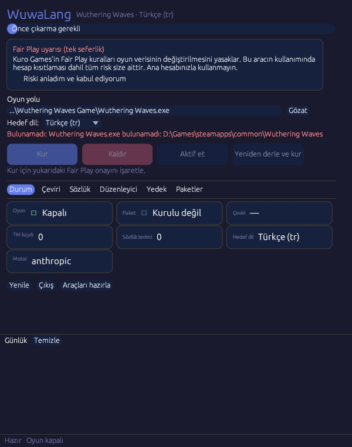
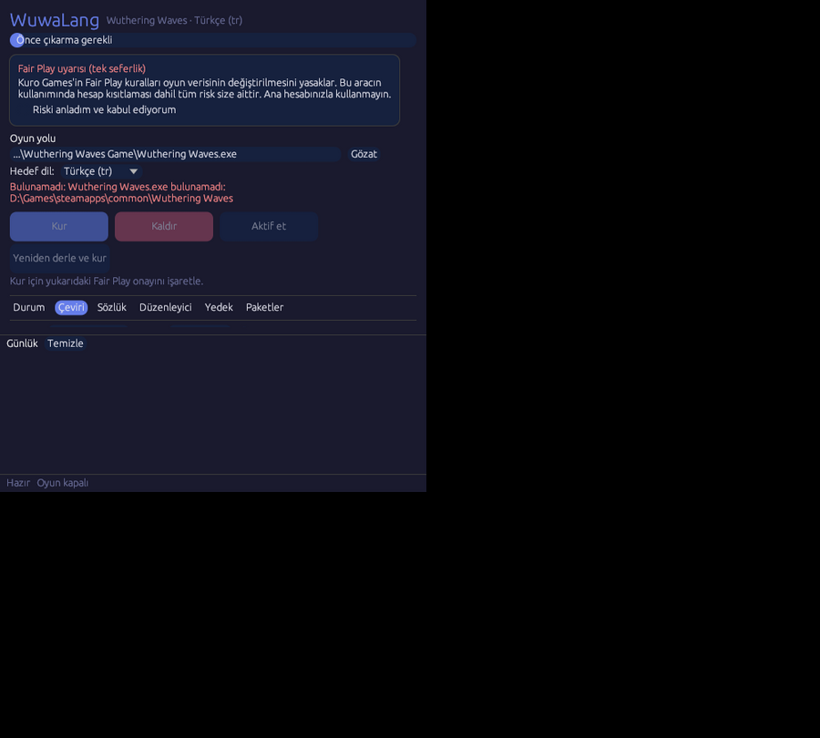

<div align="center">

# WuwaLang

**Wuthering Waves için tek exe'li, topluluk destekli Türkçe çeviri modu.**

[](https://github.com/Pulsariums/wuwalang/actions/workflows/release.yml)
[](LICENSE)
[](#gereksinimler)
[](Cargo.toml)

[Site](https://pulsariums.github.io/wuwalang/) · [İndir](https://github.com/Pulsariums/wuwalang/releases) · [Actions](https://github.com/Pulsariums/wuwalang/actions)

<p>
  
  
</p>

</div>

## Özellikler

- API anahtarlı çeviri: Yandex, Google, OpenAI uyumlu ve Anthropic uyumlu motorlar
- 19 hedef dil; her dil için ayrı çeviri belleği, sözlük ve paket klasörü
- Çeviri belleği ile tekrarlanan metinler bir kez çevrilir; istekler toplu gönderilir, veri trafiği küçük kalır
- Sözlük otomatik büyür, ancak yalnızca gerçek özel isim ve oyun terimlerini ekler (karakter, yer, grup, eşya, beceri, mekanik); isimler olduğu gibi kalır
- Topluluk çeviri paketlerini dışa aktarma, içe aktarma ve repodan çekme
- Düzenleyici ile elle düzeltme; elle girilen çeviri otomatik çeviriyle üzerine yazılmaz
- Oyunun yüzde kaçının çevrildiğini gösteren gösterge
- Otomatik yedek; oyun güncellemesinden sonra çeviri kaybolmaz, yalnızca yeni ya da değişen metinler çevrilir
- Aktif et / Devre dışı bırak ile çeviriyi tek tıkla aç ve kapat; çeviri sırasında Durdur
- F7 ile açılan ayrı pencere bindirmesi; oyuna enjeksiyon yok, oyun belleğine dokunulmaz

## Kurulum

1. [Releases](https://github.com/Pulsariums/wuwalang/releases) sayfasından `wuwalang.exe` dosyasını indirin.
2. Dosyaya argüman vermeden çift tıklayın; kurulum penceresi açılır.
3. **Gözat** ile `Wuthering Waves.exe` (veya `Client-Win64-Shipping.exe`) dosyasını seçin.
4. İlk açılışta Fair Play uyarısını okuyup onaylayın.
5. Çeviri sekmesinde bir API anahtarı girin ve **Çevir** ile metinleri çevirin.
6. **Kur** düğmesine basın. Araçlar, çıkarma, topluluk paketi, derleme ve kurulum tek seferde yapılır.

> **Not:** Kur çeviri yapmaz; yalnızca mevcut çeviri belleğini kullanır. Çeviri belleği boşsa paket kurulmaz.
> Oyunu açmadan önce kapatın. Kaldırmak için **Kaldır** düğmesini kullanın.

## Gereksinimler

- Windows 10 veya 11 (oyun ve kurulum Windows içindir; Linux'ta yalnızca metin/çeviri adımları ve testler çalışır)
- Yüklü ve güncel Wuthering Waves (Steam veya resmi başlatıcı)

## Nasıl çalışır

1. `setup` FModelCLI'yi indirip SHA-256 ile doğrular ve `pakkeys.txt` anahtar dosyasını hazırlar; `extract` oyundan İngilizce veritabanlarını çıkarır.
2. `translate` eksik metinleri seçili motorla çevirir. Sonuçlar SQLite tabanlı çeviri belleğinde saklanır; sözlük ve önceki çeviriler tutarlılığı korur.
3. `build` çeviri belleğinden WuWa V12 biçiminde `pakchunk0-WuwaLang_900_P.pak` dosyasını derler ve doğrular.
4. `install` paketi oyunun pak klasörüne yerleştirir ve mount satırını ekleyerek paketi İngilizce dil yuvasından (`Lang_en/WuwaLang`) yükletir.
5. Oyunda dil ayarı İngilizce kalır; Türkçe metinler bu yuvadan okunur. `uninstall` paketi kaldırıp İngilizceyi geri yükler.

## Çeviri motorları

| Motor       | Ortam değişkeni       | Gereken ek ayar                              | Tür                         |
|-------------|-----------------------|----------------------------------------------|-----------------------------|
| `yandex`    | `WWTR_YANDEX_API_KEY` | `yandex.folder_id`                           | Makine çevirisi             |
| `google`    | `WWTR_GOOGLE_API_KEY` | Cloud Translation v2                         | Makine çevirisi             |
| `openai`    | `WWTR_OPENAI_API_KEY` | `openai.base_url`, `openai.model`            | Yapay zekâ (OpenAI uyumlu)  |
| `anthropic` | `WWTR_ANTHROPIC_API_KEY` | `anthropic.model`                         | Yapay zekâ (Anthropic)      |

Anahtarlar `config.json` içinde ya da ortam değişkeni olarak verilebilir. Başlangıç için
`config.example.json` dosyasını `config.json` olarak kopyalayın (git'e eklenmez).

Yandex ve Google makine çevirisidir: etiketler ve sözlük terimleri jetonlarla korunur.
OpenAI uyumlu ve Anthropic motorları yapay zekâ çevirisidir: model, yeni karşılaşılan özel isimleri
`new_terms` alanında önerir; bu öneriler `glossary.json` dosyasına eklenir.

## Komut satırı

```powershell
wuwalang setup                      # FModelCLI ve pakkeys.txt hazırla (bir kez)
wuwalang extract                    # oyundan İngilizce veritabanlarını çıkar
wuwalang translate --dry-run        # API çağırmadan tahmin (paket, karakter, TM isabeti, token)
wuwalang translate --limit 50       # önce küçük bir deneme
wuwalang translate                  # eksik metinleri çevir
wuwalang build                      # çeviri belleğinden paketi derle ve doğrula
wuwalang install                    # paketi oyuna kur (oyun kapalıyken)
```

| Komut | Açıklama |
|-------|----------|
| `setup [--refresh-keys]` | Araçları hazırlar; oyun güncellenmişse anahtarları yeniler |
| `extract [--force]` | İngilizce veritabanlarını çıkarır; `--force` sürüm değişmese de yeniden çıkarır |
| `translate [--engine E] [--limit N] [--dry-run]` | Eksik metinleri çevirir; `--dry-run` API çağırmadan tahmin yazar |
| `build` | Çeviri belleğinden paketi derler ve doğrular |
| `install` / `uninstall` | Paketi kurar / kaldırır ve İngilizce dili geri yükler |
| `enable` / `disable` | Kurulu paketi etkinleştirir / devre dışı bırakır (paket dosyası kalır) |
| `langs` | Desteklenen hedef dilleri listeler (`*` etkin dil) |
| `import-pack [--dir DIR]` | Topluluk paketini çeviri belleğine alır |
| `export-pack [--dir DIR]` | Çeviri belleğini topluluk paketi olarak dışa aktarır |
| `pull-pack [--url URL]` | Paketi repodan çekip çeviri belleğine alır |
| `backup` / `backup list` | Çeviri belleğini yedekler / yedekleri listeler |
| `restore <dosya>` | Yedekten geri yükler (mevcut hali önce yedeklenir) |
| `glossary list` / `add TERİM KARŞILIK [--locked]` / `lock TERİM` / `clean [--dry-run]` | Sözlüğü yönetir |
| `ui` | Oyun üstü WuwaLang menüsünü (F7) açar |

### Oyun güncellemesinden sonra

```powershell
wuwalang setup --refresh-keys       # yalnızca oyun güncellenmişse
wuwalang extract
wuwalang import-pack                # topluluk paketi: kaynak metni değişmeyen satırlar alınır
wuwalang translate                  # yalnızca yeni veya değişmiş metinler çevrilir
wuwalang build
wuwalang install
```

Kaynak metni değişen satırlar paketten atlanır ve yeniden çevrilir. Çeviri, kaynak ya da paket işlemi
bittiğinde değişiklik varsa çeviri belleği otomatik yedeklenir; güncellemeden önce `wuwalang backup`
ile de elle yedek alabilirsiniz.

## Sözlük

Sözlüğe yalnızca özel isimler girer: karakter, yer, grup, eşya, beceri ve oyun mekaniği terimleri.
Kilitli terimler otomatik önerilerle değişmez. Modelin farklı bir karşılık önerdiği durumlar
`conflicts.log` dosyasına yazılır ve mevcut karar korunur. Modelin önerdiği girdi en fazla 4 kelime
olmalı ve cümle işareti içermemelidir; aksi halde atlanır.

Eski sürümden kalan cümle benzeri girdiler için:

```powershell
wuwalang glossary clean --dry-run   # yalnızca say ve listele
wuwalang glossary clean             # geçersiz ve kilitsiz girdileri sil (önce yedek alınır)
```

Sözlük `glossary.json` dosyasındadır. Kilitli girdiler her durumda korunur.

## Topluluk paketleri

Paketler `packs/<dil>/` klasöründe, her tablo için bir `.jsonl` dosyası ve bir `index.json` olarak tutulur.
Her satır `{"id": "<dosya>:<tablo>:<kimlik>", "src": "...", "tr": "..."}` biçimindedir.

- `export-pack` çeviri belleğini paket olarak yazar ve `index.json` dosyasını (tablo adı, sha1, satır sayısı) üretir.
- `import-pack` yerel klasördeki paketi çeviri belleğine alır.
- `pull-pack` `index.json` üzerinden repodaki paketi çeker. Değişmeyen dosyalar (sha1, `packs/.cache`) indirilmez.
  Varsayılan adres `config.json` içindeki `pack_url` alanıdır.
- Arayüzdeki **Paketler** sekmesi aynı işlemleri yapar. Kur sırasında önce yerel paket içe aktarılır, `pack_url`
  doluysa repodan çekilmeyi dener; çekme başarısız olursa yalnızca uyarı yazılır.

**Paylaşmak için:** çevirinizi `export-pack` ile dışa aktarın ve değişikliği bir
[çekme isteği](https://github.com/Pulsariums/wuwalang/pulls) ya da bir [sorun](https://github.com/Pulsariums/wuwalang/issues)
olarak iletin.

## Arayüz (F7)

```powershell
wuwalang ui
```

Oyunun sağ üst köşesinde küçük bir durum etiketi açılır (`WuwaLang aktif (tr) · F7`); **F7** ile menü açılıp kapanır.
Menüde oyun yolu, hedef dil, çevrilme yüzdesi (`X / Y`), motor ve anahtar ayarları, sözlük, düzenleyici,
yedekler ve paketler bulunur. Elle düzeltilen metin oyunda geçtiği her yerde değişir; oyuna yansıması için
**Yeniden derle ve kur** gerekir.

Bindirme yalnızca **Borderless** ya da **Windowed** modda görünür; özel tam ekran modunda görünmez.
Oyuna enjeksiyon yapılmaz, oyun belleğine dokunulmaz; arayüz kendi sürecinde çalışır.

## Yedekler

```powershell
wuwalang backup                               # çeviri belleğinin yedeğini al
wuwalang backup list                          # yedekleri tarih, kayıt sayısı ve boyutla listele
wuwalang restore backups\tm.tr.<tarih>.db     # yedekten geri yükle (mevcut hali önce yedeklenir)
```

Yedekler `backups\tm.<kod>.<YYYYMMDD-HHMMSS>.db` olarak yazılır (saat UTC) ve SQLite'ın çevrimiçi yedekleme
komutuyla alınır. Dil başına en fazla 10 yedek tutulur. Otomatik yedek; çeviri bittiğinde ya da durdurulduğunda,
Kur, Kaldır ve Derle öncesinde, çeviri belleğinde değişiklik varsa alınır. Elle düzeltilen kayıtlar yedekte ve
pakette korunur.

## Kaynaktan derleme

Rust araç zinciri gerekir:

```powershell
cargo build --release
cargo test
```

Derlenen dosya `target\release\wuwalang.exe` yoluna çıkar. Testler ağa çıkmaz; HTTP çağrıları taklit edilir.

## Sık sorulan sorular

**Hesabım yasaklanır mı?** Hesap riski vardır ve bu riski kullanıcı üstlenir. Oyun verilerinin değiştirilmesi
Kuro Games'in Fair Play kurallarına aykırıdır; bir yaptırım olmayacağını garanti edemeyiz. Ana hesabınızla kullanmayın.

**Oyuna müdahale ediyor mu?** Hayır. Çalışan oyun sürecine enjeksiyon yapılmaz; çeviri oyunun kendi dil paketi
mekanizmasıyla kurulur.

**Oyun güncellenince ne olur?** Önceki çeviriler yeniden kullanılır; yalnızca yeni ya da değişen metinler çevrilir.

**Nasıl kaldırılır?** **Kaldır** düğmesiyle ya da `wuwalang uninstall` ile. Oyun İngilizce dile döner.

**API anahtarım güvende mi?** Anahtarlar yalnızca seçtiğiniz sağlayıcıya gönderilir. Sağlayıcının panelinden
harcama sınırı koymanızı ve anahtarı kimseyle paylaşmamanızı öneririz.

## Uyarı

Kuro Games'in Fair Play kuralları oyun verisinin değiştirilmesini yasaklar. Bu aracın kullanımından doğabilecek
riskler (hesap kısıtlaması dahil) tamamen kullanıcıya aittir. Ana hesabınızla kullanmayın; ayrı bir hesap tercih edin.

## Proje yapısı

| Yol                    | İçerik                                                     |
|------------------------|------------------------------------------------------------|
| `src/main.rs`          | Komut satırı (clap)                                        |
| `src/game.rs`          | Araç hazırlama, çıkarma, derleme, kurma, kaldırma          |
| `src/pak.rs`           | WuWa V12 paket yazıcısı                                    |
| `src/batching.rs`      | TM isabeti, tekilleştirme, paketleme, çalıştırma           |
| `src/tm.rs`            | SQLite çeviri belleği ve topluluk paketi                   |
| `src/glossary.rs`      | Kalıcı sözlük                                              |
| `src/backup.rs`        | Çeviri belleği yedekleri ve geri yükleme                   |
| `src/placeholders.rs`  | Yer tutucu koruma ve denetimi                              |
| `src/prompt.rs`        | Yapay zekâ istemi ve yanıt ayrıştırma                      |
| `src/engines/`         | Yandex, Google, OpenAI uyumlu, Anthropic motorları         |
| `src/ui/`              | F7 bindirmesi ve menü                                      |
| `packs/tr/`            | Topluluk çeviri paketi                                     |
| `glossary.json`        | Sözlük                                                     |

## Lisans ve atıf

- Bu proje **GPL-3.0-or-later** lisanslıdır; tam metin [LICENSE](LICENSE) dosyasındadır.
- Temel alınan kaynak: [GishReloaded/WuWaRu](https://github.com/GishReloaded/WuWaRu) (GPL-3.0-or-later).
  `src/game.rs` (kurulum, çıkarma, derleme, kurma) ve `src/pak.rs` (WuWa V12 paket yazıcısı) bu projeden uyarlanmıştır.
  Çeviri motoru katmanı, sözlük, çeviri belleği, arayüz ve CLI bu projeye özgüdür.
- Oyun verisini okumak için kullanılan FModelCLI v1.0.2 (GPL-3.0) `wuwalang setup` komutuyla resmi sürümden indirilir
  ve SHA-256 ile doğrulanır. İkili dosya depoya eklenmez. Bkz. <https://github.com/Herselfta/FModelCLI>
- Wuthering Waves ve ilgili tüm varlıklar Kuro Games'in mülkiyetindedir. Bu proje resmi bir ürün değildir.
